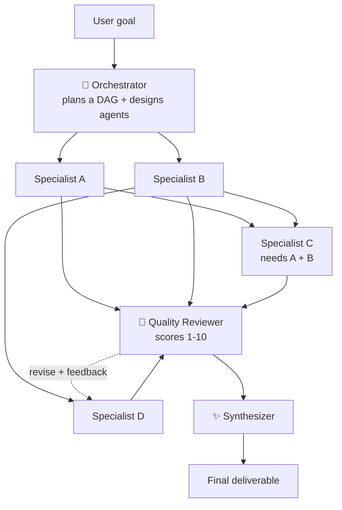

# Multi-Agent Orchestration

**One goal. A whole team of AI agents. You watch them work, live.**

You give it a goal. An **Orchestrator** agent turns that goal into a task graph and designs a specialist agent for each task. The agents **run in parallel** and hand their outputs to whoever depends on them. A **Quality Reviewer** scores every deliverable and sends weak ones back for revision. A **Synthesizer** merges everything into one final deliverable.

Every step streams to a live dashboard, so you can see the orchestration happen.

**Runs free on Google Gemini** (free API key from [Google AI Studio](https://aistudio.google.com/apikey)). Anthropic Claude is also supported as a second provider.

## What you see

| View | What it shows |
|---|---|
| **Agent graph** | The DAG the orchestrator designed. Nodes light up while an agent works. Edges animate as context flows downstream. An amber loop appears when the reviewer sends work back. |
| **Agent feed** | Each agent's output streaming token by token, with status, timing, token counts and review scores. |
| **Event bus** | A terminal-style log of every orchestration event. |
| **Execution timeline** | A Gantt chart of every agent. Overlapping bars show real parallelism; striped bars are revisions. |
| **Inspector** | Click any agent to see its role, its instructions from the orchestrator, the context it received, its review and its first draft vs. its revision. |
| **Final deliverable** | The synthesized result, rendered as Markdown. You can copy it or download it as a `.md` file. |

## Architecture



### The engine (`lib/orchestrator.js`)

The engine is **provider-agnostic**. It only calls two methods, `provider.json()` (structured output) and `provider.stream()` (streamed text), which are implemented for each LLM in `lib/providers/`:

| Provider | Structured output | Streaming |
|---|---|---|
| **Google Gemini** (default, free tier) | JSON mode + `responseSchema` (JSON Schema converted to Gemini's format) | `streamGenerateContent?alt=sse` |
| **Anthropic Claude** | forced tool call (`tool_choice`) | Messages API SSE |

1. **Plan.** The orchestrator returns structured JSON that must match the `create_plan` schema: the goal, a strategy, and 3–6 tasks, each with an agent persona, instructions and `depends_on`. `sanitizePlan()` then cleans the plan: it makes IDs unique and keeps only dependencies on earlier tasks, which guarantees the graph has no cycles.
2. **Execute.** A DAG scheduler starts every task whose dependencies are done, up to 4 at once. Each agent gets its own system prompt and its upstream teammates' outputs as context, and it streams its work.
3. **Review.** A reviewer returns JSON matching the `submit_review` schema: a score, a verdict and actionable feedback for each task.
4. **Revise.** The weakest deliverables (at most 2) go back to their agents with the feedback and the previous draft. These revisions run in parallel.
5. **Synthesize.** A final agent merges everything into one polished answer, and streams it.

Every step emits typed events (`plan`, `task_start`, `task_delta`, `review`, `synth_delta`, `usage`, `run_done`, …). These are streamed to the browser as **NDJSON** over a single HTTP response from a Vercel Function.

### Design choices

- **Dependency-free API clients** (`lib/providers/`). Both call their REST APIs directly with `fetch` and parse the streaming responses themselves. They retry on 429/5xx errors, and Gemini's retries honour Google's `RetryInfo` delay. Each retry is shown on the event bus, so free-tier rate limits are visible instead of silent.
- **Structured output** (JSON schema mode or forced tool use). Plans and reviews come back as JSON matching a schema, instead of free text that would need fragile parsing.
- **Cancellation.** If you close the tab or press Stop, the in-flight model calls are aborted.
- **Demo mode** replays recorded runs through the *same* event protocol and the same scheduling rules, so the app works for anyone, even without an API key.

## Running it

### Live demo
Open the deployed link. Without an API key it starts in **Demo replay** mode, with three recorded scenarios. To run real agents on any goal:

1. Get a **free** Gemini API key at [aistudio.google.com/apikey](https://aistudio.google.com/apikey).
2. On the site, open **Settings**, choose **Live agents** and **Gemini · free**, paste the key, then **Save**.

The key stays in your browser and is sent only to this app's API. Or set `GEMINI_API_KEY` on the deployment, so every visitor gets Live mode with no key needed.

### Locally
```bash
npm install
npm run dev            # http://localhost:5173 (the API routes run inside Vite)
```
Set `GEMINI_API_KEY` (free) or `ANTHROPIC_API_KEY` in your environment, or paste a key into Settings in the UI.

### Environment variables
| Variable | Purpose |
|---|---|
| `GEMINI_API_KEY` (or `GOOGLE_API_KEY`) | Server-side Gemini key. If set, every visitor runs Live mode for free, with no key needed. |
| `GEMINI_MODEL` | Default Gemini model: `gemini-3.5-flash-lite` (most free requests per day), `gemini-3.8-flash`, `gemini-3.6-flash` or `gemini-3.1-flash-lite`. |
| `ANTHROPIC_API_KEY` | Optional server-side Claude key (paid). |
| `ANTHROPIC_MODEL` | Default Claude model (`claude-sonnet-5-5`, `claude-haiku-5-5` or `claude-opus-5-5`). |
| `LLM_PROVIDER` | `gemini` (default) or `anthropic`. |
| `GEMINI_BASE_URL` / `ANTHROPIC_BASE_URL` | Optional API base URLs, for proxies or local mocks. |

> **Free-tier notes:** a run makes about 9–11 model requests. The Gemini free tier has per-minute and per-day limits for each Google project (Flash-Lite allows the most), and those limits are shared by every visitor if you set a server key. Google may use free-tier prompts to improve its products. On a paid key, set a spend limit.

## Project structure
```
api/
  orchestrate.js   # POST: streams the orchestration as NDJSON (Vercel Function, 300s max)
  health.js        # GET: reports whether a server key is configured
lib/
  orchestrator.js  # plan → parallel DAG execution → review → revise → synthesize
  providers/
    index.js       # provider registry + server-key lookup
    gemini.js      # Gemini generateContent / SSE streaming, schema conversion, RetryInfo backoff
    anthropic.js   # Claude Messages API, forced tool use, SSE streaming
src/
  App.jsx          # layout, run control, event batching
  lib/state.js     # event-stream reducer, parallelism metrics
  lib/engines.js   # live NDJSON reader + demo replayer
  lib/scenarios.js # recorded demo runs
  components/      # Graph, AgentFeed, Timeline, Inspector, Report, Settings
```

## Tech
React 19 · Vite · Vercel Functions (Node) · Google Gemini API · Anthropic Messages API · marked + DOMPurify

---
Built by [Ashfar Faizi](https://github.com/ashfarfaizi).
