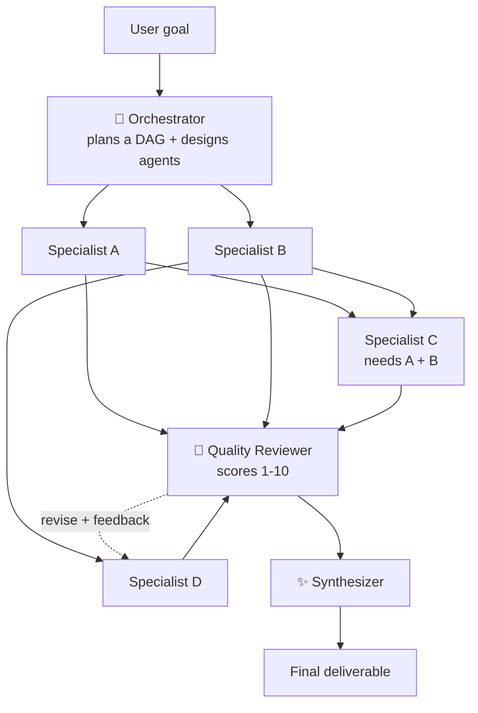

# Multi-Agent Orchestration

**One goal. A whole team of AI agents. You watch them work, live.**

You give it a goal. An **Orchestrator** agent turns that goal into a task graph and designs a specialist agent for each task. The agents **run in parallel** and hand their outputs to whoever depends on them. A **Quality Reviewer** scores every deliverable and sends weak ones back for revision. A **Synthesizer** merges everything into one final deliverable.

Every step streams to a live dashboard, so you can see the orchestration happen.

## What you see

| View | What it shows |
|---|---|
| **Agent graph** | The DAG the orchestrator designed. Nodes light up while an agent works. Edges animate as context flows downstream. An amber loop appears when the reviewer sends work back. |
| **Agent feed** | Each agent's output streaming token by token, with status, timing, token counts and review scores. |
| **Event bus** | A terminal-style log of every orchestration event. |
| **Execution timeline** | A Gantt chart of every agent. Overlapping bars show real parallelism; striped bars are revisions. |
| **Inspector** | Click any agent to see its role, its instructions from the orchestrator, the context it received, its review and its first draft vs. its revision. |
| **Final deliverable** | The synthesized result, rendered as Markdown. You can copy it or download it as a `.md` file. |

## Architecture



### The engine (`lib/orchestrator.js`)

1. **Plan.** The orchestrator is forced to call a `create_plan` tool, so it returns structured JSON: the goal, a strategy, and 3–6 tasks, each with an agent persona, instructions and `depends_on`. `sanitizePlan()` then cleans the plan: it makes IDs unique and keeps only dependencies on earlier tasks, which guarantees the graph has no cycles.
2. **Execute.** A DAG scheduler starts every task whose dependencies are done, up to 4 at once. Each agent gets its own system prompt and its upstream teammates' outputs as context, and it streams its work.
3. **Review.** A reviewer is forced to call a `submit_review` tool. It returns a score, a verdict and actionable feedback for each task.
4. **Revise.** The weakest deliverables (at most 2) go back to their agents with the feedback and the previous draft. These revisions run in parallel.
5. **Synthesize.** A final agent merges everything into one polished answer, and streams it.

Every step emits typed events (`plan`, `task_start`, `task_delta`, `review`, `synth_delta`, `usage`, `run_done`, …). These are streamed to the browser as **NDJSON** over a single HTTP response from a Vercel Function.

### Design choices

- **Dependency-free API client** (`lib/anthropic.js`). It calls the Anthropic Messages API directly with `fetch`, parses the streaming responses itself, and retries with exponential backoff on 429/5xx/529 errors.
- **Structured output through forced tool use.** Plans and reviews come back as validated JSON instead of free text that would need fragile parsing.
- **Cancellation.** If you close the tab or press Stop, the in-flight model calls are aborted.
- **Demo mode** replays recorded runs through the *same* event protocol and the same scheduling rules, so the app works for anyone, even without an API key.

## Running it

### Live demo
Open the deployed link. Without an API key it starts in **Demo replay** mode, with three recorded scenarios. To run real agents on any goal, open **Settings**, choose **Live agents**, and paste an Anthropic API key. The key stays in your browser and is sent only to this app's API.

### Locally
```bash
npm install
npm run dev            # http://localhost:5173 (the API routes run inside Vite)
```
Set `ANTHROPIC_API_KEY` in your environment, or paste a key into Settings in the UI.

### Environment variables
| Variable | Purpose |
|---|---|
| `ANTHROPIC_API_KEY` | Optional server-side key. If set, every visitor can run Live mode without entering their own key. |
| `ANTHROPIC_MODEL` | Optional default model (`claude-sonnet-5-5`, `claude-haiku-5-5` or `claude-opus-5-5`). |
| `ANTHROPIC_BASE_URL` | Optional API base URL, for proxies or local mocks. |

> ⚠️ If you set `ANTHROPIC_API_KEY` on a public deployment, anyone with the link can spend your credits. Use a key with a spend limit.

## Project structure
```
api/
  orchestrate.js   # POST: streams the orchestration as NDJSON (Vercel Function, 300s max)
  health.js        # GET: reports whether a server key is configured
lib/
  orchestrator.js  # plan → parallel DAG execution → review → revise → synthesize
  anthropic.js     # minimal streaming Messages API client with retries
src/
  App.jsx          # layout, run control, event batching
  lib/state.js     # event-stream reducer, parallelism metrics
  lib/engines.js   # live NDJSON reader + demo replayer
  lib/scenarios.js # recorded demo runs
  components/      # Graph, AgentFeed, Timeline, Inspector, Report, Settings
```

## Tech
React 19 · Vite · Vercel Functions (Node) · Anthropic Messages API (streaming + tool use) · marked + DOMPurify

---
Built by [Ashfar Faizi](https://github.com/ashfarfaizi).
